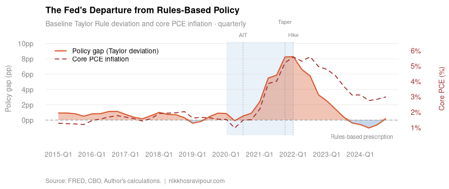

<p><picture><source media="(prefers-color-scheme: dark)" srcset="assets/banner-dark.svg"></picture></p>

**From 2015 to 2024 the effective federal funds rate sat below its baseline Taylor-rule prescription in 33 of 40 quarters, by as much as 8.3 pp in Q1 2022, and the gap carries statistically significant predictive content for core PCE inflation one to two quarters ahead.**

[Paper](https://nikkhosravipour.com/post/discretion-over-rules-federal-reserve-policy-departures-and-the-inflation-surge-of-2021-2022) · [Data](#data-availability) · [Site](https://nikkhosravipour.com)

[](https://doi.org/10.5281/zenodo.23404665) [](LICENSE) [](LICENSE-docs) [](https://www.r-project.org/)

<picture><source media="(prefers-color-scheme: dark)" srcset="output/figures/fig0_hook-dark.png"></picture>

> [!NOTE]
> Needs R 4.0 or later and a free FRED API key. Sample window 2015 Q1 to 2024 Q4, FRED vintage 2026-09-08 (pinned in `R/config.R`). The published figures predate that pin; see [Data availability](#data-availability).

This is the replication package for the deep dive [*Discretion Over Rules: Federal Reserve Policy Departures and the Inflation Surge of 2021–2022*](https://nikkhosravipour.com/post/discretion-over-rules-federal-reserve-policy-departures-and-the-inflation-surge-of-2021-2022). R pulls quarterly macroeconomic series from FRED, computes three Taylor-rule specifications and an ECB comparison, and tests for Granger causality and cross-correlation between the deviations and core PCE inflation. It exports Chart.js widgets and static PNG fallbacks.

## Quick start

1. Clone: `git clone https://github.com/nik110403/taylor-rule.git && cd taylor-rule`
2. Get a free FRED API key at <https://fredaccount.stlouisfed.org/apikeys>, then `cp .Renviron.example .Renviron` and set `FRED_API_KEY=` to your key. R loads `.Renviron` from the project root.
3. Run everything from the repo root: `Rscript run_all.R`. Missing packages (`fredr`, `dplyr`, `vars`, `tseries`, `lmtest`, `zoo`, `lubridate`) install on first run through `R/setup.R`.
4. Check the result: the run ends with a checklist of every expected output file. PNG figures are in `output/figures/`, widgets in `output/widgets/`.

## Exhibit map

| Exhibit | Script | Output |
|---|---|---|
| Hook: policy gap and core PCE inflation | `R/04_hook_figure.R`, `R/04_pngs.R` | `output/figures/fig0_hook.png`, `output/widgets/fig0_hook.html` |
| Three Taylor-rule variants against the funds rate | `R/03_figures.R`, `R/04_pngs.R` | `output/figures/fig1_taylor_vs_actual.png`, `output/widgets/fig1_taylor_vs_actual.html` |
| Baseline deviation by quarter | `R/03_figures.R`, `R/04_pngs.R` | `output/figures/fig2_deviation.png`, `output/widgets/fig2_deviation.html` |
| Deviation against core PCE two quarters later | `R/03_figures.R`, `R/04_pngs.R` | `output/figures/fig3_scatter.png`, `output/widgets/fig3_scatter.html` |
| ECB deviation against euro area HICP | `R/03_figures.R`, `R/04_pngs.R` | `output/figures/fig4_ecb.png`, `output/widgets/fig4_ecb.html` |
| Cross-correlation across lags | `R/03_figures.R`, `R/04_pngs.R` | `output/figures/fig5_ccf.png`, `output/widgets/fig5_ccf.html` |
| VAR(4) assumption diagnostics | `R/05_assumption_checks.R` | `output/assumption_report.md` |

The paper numbers its figures in reading order, so its Figure 1 is the hook and its Figure 2 is `fig1_taylor_vs_actual`, and so on.

### Method

Three US variants, all floored at zero:

| Rule | Formula | r\* | Notes |
|---|---|---|---|
| Baseline | r\* + π + 0.5(π − π\*) + 0.5·y_gap | 0.5% | Post-GFC Laubach-Williams |
| Alternative | same | 1.0% | Robustness |
| Inertial | 0.75·r_{t−1} + 0.25·baseline | 0.5% | Partial adjustment |

π is core PCE year-over-year %, π\* is 2%, and y_gap = 100·(GDPC1 − GDPPOT)/GDPPOT.

The ECB comparison (`fig4`) uses r\* = 1.0%, euro area HICP for π and no output-gap term, because euro area potential output is not available on FRED. It is prescribed against `ECBDFR`.

`R/02_analysis.R` runs ADF stationarity tests on inflation and the deviation series, bivariate Granger causality at lags 1 to 4 in both directions, VAR(4) Granger causality (`vars::causality`), and a cross-correlation of the baseline deviation against core PCE at lags 0 to 8 quarters. `R/05_assumption_checks.R` reports normality, serial-correlation and heteroskedasticity diagnostics for the VAR(4).

## Data availability

All data come from [FRED](https://fred.stlouisfed.org/) and are subject to its terms. They are public. They are not covered by the code licence.

| Series ID | Description | Transformation |
|---|---|---|
| `FEDFUNDS` | Effective federal funds rate | levels |
| `PCEPILFE` | Core PCE deflator | YoY % (`pc1`) |
| `PCEPI` | Headline PCE deflator | YoY % (`pc1`) |
| `GDPC1` | Real GDP | levels |
| `GDPPOT` | CBO potential real GDP | levels |
| `UNRATE` | Unemployment rate | levels |
| `NROU` | Natural rate of unemployment (CBO) | levels |
| `ECBDFR` | ECB deposit facility rate | levels |
| `CP0000EZ19M086NEST` | Euro area HICP | YoY % (`pc1`) |

Monthly series convert to quarterly by taking the last observation of each quarter. The raw pulls are not committed to this repository (`data-raw/` is git-ignored); `R/01_data.R` writes them locally.

Vintage and revisions:

- FRED revises historical series, including `GDPPOT` (CBO potential output), with each CBO Budget and Economic Outlook. Results reproduce exactly only against the vintage retrieved for the published piece. Later pulls shift the output-gap series and therefore every Taylor prescription.
- The sample window is locked at 2015 Q1 to 2024 Q4 in `R/config.R` (`START_DATE`, `END_DATE`).
- `R/config.R` pins `FRED_VINTAGE` (2026-09-08), passed as `realtime_start` and `realtime_end` on every FRED pull, with the raw response archived under `data-raw/fred/<FRED_VINTAGE>/`. The published figures predate this pin and reflect whatever FRED reported at publication time. Re-running `R/01_data.R` reproduces the FRED state as of `FRED_VINTAGE`, which diverges from the published numbers as FRED revises `GDPPOT` and other series.
- The paper documents the vintage used and the direction of any revisions.

## Repository layout

```text
taylor-rule/
├── run_all.R              # runs the pipeline in order, then lists expected outputs
├── R/
│   ├── config.R               # sample window, π*, r* assumptions, FRED key
│   ├── setup.R                # package management
│   ├── 01_data.R              # FRED pull, quarterly conversion -> output/data/df_quarterly.rds
│   ├── 02_analysis.R          # Taylor variants, ECB rule, ADF/Granger/CCF -> df_analysis.rds, df_ccf.rds
│   ├── 03_figures.R           # Chart.js widgets, figures 1 to 5
│   ├── 04_hook_figure.R       # hook widget (fig0)
│   ├── 04_pngs.R              # static PNG export
│   └── 05_assumption_checks.R # VAR(4) diagnostics -> output/assumption_report.md
├── output/
│   ├── figures/           # PNG figures
│   ├── widgets/           # Chart.js fragments (*.html)
│   └── assumption_report.md
├── assets/                # banner and social preview (made by tools/banner)
├── .Renviron.example      # template for the FRED API key
├── CITATION.cff
├── LICENSE                # MIT (code)
└── LICENSE-docs           # CC BY 4.0 (text and figures)
```

The `*.rds` files are written to `output/data/` at run time and are not committed. The widgets load Chart.js 4.4.1 from jsDelivr and follow the author's site embed contract (theme set by the `is-light` class on `<body>`). To reuse one, paste the HTML fragment into a page that serves Chart.js from the same CDN.

## Citation

Archived on Zenodo: [doi:10.5281/zenodo.23404665](https://doi.org/10.5281/zenodo.23404665) (all versions). GitHub shows a "Cite this repository" button from `CITATION.cff`. BibTeX:

<details>
<summary>BibTeX</summary>

```bibtex
@misc{taylor_rule2026,
  author = {Khosravipour, Nik},
  title  = {Discretion Over Rules: Federal Reserve Policy Departures and the Inflation Surge of 2021--2022},
  year   = {2026},
  doi    = {10.5281/zenodo.23404665},
  url    = {https://github.com/nik110403/taylor-rule}
}
```

</details>

## License

Code: [MIT](LICENSE). Text and figures: [CC BY 4.0](LICENSE-docs). Third-party data (FRED, CBO) is not covered by either licence and stays subject to its source terms.
